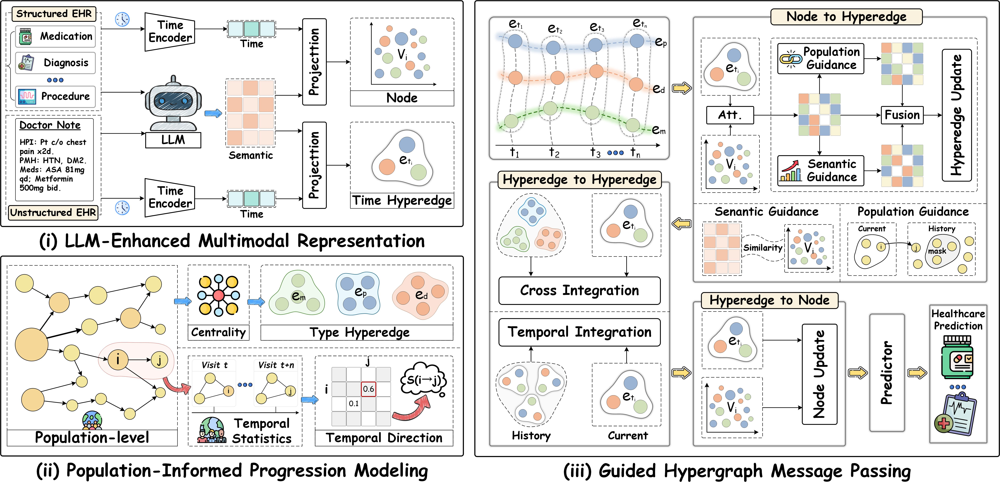

# [MM'2026] HyperCare: Longitudinal Heterogeneous Hypergraph Neural Network for Healthcare Prediction

[](#)

This repository contains the official implementation of **HyperCare**, accepted by **ACM Multimedia 2026**.



## Overview
HyperCare is a longitudinal heterogeneous hypergraph neural network for modeling patient health trajectories from multimodal EHRs. It integrates guided hypergraph message passing to capture subtle risk signals and clinically meaningful longitudinal health dynamics.

## Repository Structure
- `benchmarks/` Task definitions, metrics, and baseline models.
- `core/` Dataset loading, task specs, model factory, and trainer adapter.
- `models/` HyperCare model, online encoder, and offline hypergraph construction.
- `preprocess/` Scripts for LLM-enhanced note/code embeddings and auxiliary preprocessing.
- `source/` Figures and static assets.

## Supported Tasks and Models

| Task | Datasets | Models |
|---|---|---|
| Diagnosis prediction | `mimic3`, `mimic4` | `HyperCare`, `Transformer`, `RETAIN`, `StageNet`, `TRANS` |
| Drug recommendation | `mimic3`, `mimic4` | `HyperCare`, `Transformer`, `RETAIN`, `StageNet`, `Deepr`, `AdaCare`, `ConCare`, `GRASP`, `DrAgent`, `SafeDrug`, `GAMENet`, `MICRON`, `MoleRec`, `TRANS` |

## Datasets
HyperCare uses structured EHR records from MIMIC-III and MIMIC-IV through PyHealth.

Unstructured EHR notes are used only for local summary embeddings:
- MIMIC-IV notes: `discharge.csv` from MIMIC-IV.
- MIMIC-III notes: `NOTEEVENTS.csv` from MIMIC-III.

MIMIC data and generated artifacts are not included in this repository.

## Quick Start

Create the environment first:

```bash
conda env create -f environment.yml
conda activate hypercare
```

This environment was prepared for experiments on an NVIDIA RTX 4090 with CUDA 11.8 and PyTorch 2.1.2.

### 1) Diagnosis prediction
```bash
python main.py \
  --task diag \
  --dataset mimic3 \
  --model HyperCare \
  --data_root <PATH_TO_MIMIC3_HOSP>
```

### 2) Drug recommendation
```bash
python main.py \
  --task drug \
  --dataset mimic3 \
  --model HyperCare \
  --data_root <PATH_TO_MIMIC3_HOSP>
```

### 3) Run a baseline (example)
```bash
python main.py \
  --task drug \
  --dataset mimic3 \
  --model Transformer \
  --data_root <PATH_TO_MIMIC3_HOSP>
```

## Notes
- `data_root` is required. Use the path to the corresponding MIMIC-III or MIMIC-IV hospital module directory.
- HyperCare can run without LLM-generated embeddings.
- If `note_emb_path` is omitted or missing, zero note embeddings are used.
- If `node_emb_path` is omitted or missing, code embeddings are randomly initialized.
- When note embeddings are provided, set `note_emb_dim` to the encoder output dimension: `clinical-longformer` = 768, `bioclinicalbert` = 768, `bge-m3` = 1024.

## LLM-Enhanced Embeddings

Start a Qwen2.5 OpenAI-compatible vLLM server:

```bash
vllm serve Qwen/Qwen2.5-7B-Instruct \
  --host 127.0.0.1 \
  --port 8000
```

### Clinical Note Summaries
Generate summaries for admissions used by the selected task:

```bash
python preprocess/build_note_summaries.py \
  --dataset mimic4 \
  --task drug \
  --data_root <PATH_TO_MIMIC4_HOSP> \
  --note_csv <PATH_TO_MIMIC_IV_NOTE>/discharge.csv \
  --output_jsonl ./results/mimic4_note_summaries.jsonl \
  --api_base http://127.0.0.1:8000/v1 \
  --model Qwen/Qwen2.5-7B-Instruct \
  --resume
```

Encode summaries into `note_emb_path`:

```bash
python preprocess/embed_note_summaries.py \
  --dataset mimic4 \
  --summary_jsonl ./results/mimic4_note_summaries.jsonl \
  --output_npy ./results/mimic4_note_emb.npy \
  --encoder bge-m3 \
  --resume
```

### Semantic Code Embeddings
Generate `node_emb_path` from CCS/ATC code descriptions:

```bash
python preprocess/build_node_embeddings.py \
  --task drug \
  --dataset mimic4 \
  --data_root <PATH_TO_MIMIC4_HOSP> \
  --description_jsonl ./results/drug_mimic4_node_descriptions.jsonl \
  --output_npy ./results/drug_mimic4_node_emb.npy \
  --api_base http://127.0.0.1:8000/v1 \
  --llm_model Qwen/Qwen2.5-7B-Instruct \
  --encoder bge-m3 \
  --resume
```

Use generated embeddings in training:

```bash
python main.py \
  --task drug \
  --dataset mimic3 \
  --model HyperCare \
  --data_root <PATH_TO_MIMIC3_HOSP> \
  --note_emb_path ./results/mimic3_note_emb.npy \
  --note_emb_dim 1024 \
  --node_emb_path ./results/drug_mimic3_node_emb.npy
```

The default encoder is `bge-m3`, which outputs 1024-dimensional embeddings. Supported encoder presets are `clinical-longformer`, `bioclinicalbert`, and `bge-m3`.

## Environment
The recommended environment is provided in `environment.yml`.

Key versions:
- Python 3.10
- CUDA 11.8
- PyTorch 2.1.2
- PyTorch Geometric 2.3.1
- torch-scatter 2.1.2
- torch-sparse 0.6.18
- PyHealth 1.1.6

<h2> Citation</h2>
```bibtex
@inproceedings{hypercare2026,
  title     = {HyperCare: Longitudinal Heterogeneous Hypergraph Neural Network for Healthcare Prediction},
  author    = {TBD},
  booktitle = {Proceedings of the ACM International Conference on Multimedia},
  year      = {2026}
}
```

## Contact
For questions, contact tianyuxuan@std.uestc.edu.cn.
